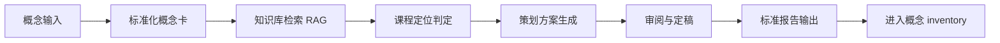
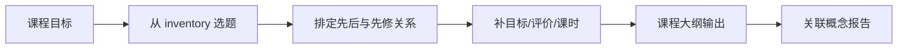

# 工作流设计：概念库存 + 课程组装的可复用生产流水线

日期：2026-11-02
版本：1.1
用途：定义"概念 → 概念库存（inventory）→ 课程组装 → 报告"的可复用工作流
关联：`01-选型建议.md`（底座选型）、`../reports/03-卷积可视化-Pilot报告.md`（首份报告样例）、`../knowledge-base/04-知识库映射表.md`（RAG 知识库）、`../inventory/05-概念Inventory.md`（概念库存）、`../策划报告.md`

## 一 工作流的两个层次

工作流要支持两类产出，分属两层：

| 层 | 输入 | 输出 | 意义 |
| --- | --- | --- | --- |
| 概念层 | 一个概念（如"卷积""光的折射""汉诺塔"） | 概念卡 + 标准报告，进入**概念 inventory** | 零散、好可视化、好学的概念先作为 prototype 沉淀下来 |
| 课程层 | inventory 中的一批概念 + 课程目标 | 一门课程（初高中 AI / Intro to AI / Intro to Discrete Math…） | 按需把库存组装成有结构、有先后顺序的课 |

关键判断：**概念先沉淀，课程后组装**。像卷积这样"零散但好可视化、且大多不在初高中课本上"的概念，不必等某门课立项才被记录；它们先在 inventory 里作为 prototype 待着，之后随时被多门课程复用。

## 二 概念入库流水线（概念 → inventory）



### 阶段 0：概念输入与澄清

- 输入：概念名 + 目标学段（初高中 / 大学衔接 / 未定）+ 可选教材版本/科目/设备/课时。
- 产出：**概念卡**——概念名、同义/上位/下位概念、学科归属假设、已知约束。
- 规则：信息不足时显式保留未知项；目标学段可以标"未定"，由定位阶段判定。

### 阶段 1：知识库检索（RAG）

- 输入：概念卡。
- 动作：按教材版本/科目过滤，再关键词 + 语义检索。
- 产出：带来源的候选证据——知识点、所属课标条目、年级/学段标签。
- 依据：`../knowledge-base/04-知识库映射表.md` 定义的公开课标映射；**不要求页码级引用**。
- 关键约束："检索到相似内容" ≠ "该概念属于该教材"。命中不足时返回"缺证据/多版本候选/库外内容"。

### 阶段 2：课程定位判定（三分类）

| 结论 | 判定依据 | 后续动作 | 典型例子 |
| --- | --- | --- | --- |
| 初高中课内 | 课标/教材目录中有该知识点 | 定位到具体年级/科目/章节 | 凸透镜（初中物理） |
| 大学先修/衔接 | 大学理工科知识库中有 | 标记为"拓展/衔接"，给大学先修定位 | 卷积（信号与系统） |
| 库外原型 | 两个库都没有，但可视化/教学价值高 | 标记为"原型/拓展"，作为 prototype 进库存 | 汉诺塔、多数零散可视化概念 |

**第三类是本工作流的关键**：大量"零散但好可视化、不在初高中课本上"的概念都落在这里。它们不进任何课标，但进入 inventory 作为课程组装的素材。

### 阶段 3：策划方案生成

- 输入：概念卡 + 定位结论 + 证据。
- 产出：策划方案——学习目标、先修知识、常见误解、交互方案、评价方式、结束条件。
- 规则：内容依据来自检索证据；物理/数学规则由确定性描述约束；AI 只组织与表达。

### 阶段 4：审阅与定稿

- 审阅点：概念定义是否准确、课程定位是否有来源、课件设计是否服务教学目标、是否有无来源断言。
- 规则：缺证据 → 回阶段 1 或标"待核实"；关键错误 → 阻断定稿。

### 阶段 5：标准报告输出

- 按第七节模板输出 md，落盘，并登记一条 inventory 记录（见 `../inventory/05-概念Inventory.md`）。
- "来源/待核实"字段强制非空。

## 三 课程组装流水线（inventory → 课程）



| 步骤 | 输入 | 输出 |
| --- | --- | --- |
| 选题 | inventory + 课程目标（学段/主题） | 概念候选集 |
| 排序 | 概念卡的先修关系（知识库 parent 字段） | 概念序列 |
| 补全 | 序列 + 教学约束 | 学习目标、评价、课时、设备 |
| 输出 | 上述全部 | 课程大纲（syllabus），每个概念回链到报告 |

一门课程可以是：初高中 AI 课程、Intro to AI（贴合大学）、Intro to Discrete Math 等。同一概念可被多门课程复用，课程只持有"对概念的引用"，不复制概念内容。

## 四 知识库 Schema（第一阶段：公开课标映射）

第一阶段只建"公开课标 + 教材目录"的**知识点映射库**，不做页码级正文引用。知识库见 `../knowledge-base/04-知识库映射表.md`。

每条知识单元至少：

| 字段 | 说明 |
| --- | --- |
| concept_id | 知识点编号 |
| name | 知识点名 |
| subject | 学科（数学/物理/信息科技/计算机…） |
| stage | 学段（义务1-9 / 高中 / 大学） |
| grade | 年级或开课学期 |
| source | 来源（课标名/教材目录名/培养方案） |
| parent | 上位概念 |
| note | 备注/待核实标记 |

三期扩展：
- 一期：人教版初高中（义务信息科技 2022 课标 + 高中信息技术/数学/物理目录）。
- 二期：211/985 理工科培养方案与核心课程大纲（信号与系统、数字信号处理、图像处理、深度学习等）。
- 三期：其他学科/出版社，按需补充。

## 五 工具清单（先内部函数，后 MCP）

| 工具 | 输入 | 输出 | 约束 |
| --- | --- | --- | --- |
| `search_curriculum(concept)` | 概念名 + 可选过滤 | 带来源的知识点候选 | 只检索获准材料 |
| `classify_stage(concept)` | 概念名 | 定位判定表（三分类） | 结论必须附来源 |
| `draft_lesson_plan(spec)` | 概念卡 + 定位 + 证据 | 策划方案 | 缺证据项显式保留 |
| `render_report(spec)` | 策划方案 | 标准 md 报告 | 按模板强制字段 |
| `register_inventory(report)` | 报告 | inventory 记录 | 回链报告路径 |
| `assemble_course(spec)` | 课程目标 + 概念序列 | 课程大纲 | 只引用不复制概念 |

## 六 inventory 与课程的数据结构

- `../inventory/05-概念Inventory.md`：概念原型的登记表，每行一个概念，含 concept_id、名称、定位三分类、报告路径、可组课标签。
- 课程大纲：单独文件，引用 inventory 的 concept_id 与报告路径。

syllabus = 某门课程的课程大纲，是"课程组装"的产物，不再是工作流的唯一出口。

## 七 标准报告模板（阶段 5 的骨架）

```
# {概念名} 可视化课件策划报告
## 一 概念定义（准确 + 直觉两个层面）
## 二 课程覆盖定位（初高中课内 / 大学先修 / 库外原型，附来源）
## 三 可视化课件设计（教学目标 / 交互步骤 / 实验设计）
## 四 与教材的衔接（定位到的知识点 + 待核实项）
## 五 验收与风险（正确性 / 教学价值 / 数据边界）
## 六 来源与判断边界（引用 + 待核实清单）
```

Pilot 报告 `../reports/03-卷积可视化-Pilot报告.md` 按此模板产出。

## 八 在 DSH 中的编排映射（正常 DSH，不含 super-agent）

| 流水线阶段 | DSH 落地 |
| --- | --- |
| 概念输入 | 一次会话输入 + 概念卡工具 |
| 知识库检索 | 独立 RAG 模块，经 MCP 暴露为 `search_curriculum` |
| 课程定位 | Tool `classify_stage`，可配内容助理 skill |
| 策划生成 | 内容助理 skill（教材 + 教学设计） |
| 审阅定稿 | 质量评价 skill + 人工确认 |
| 报告输出 | Tool `render_report` 落盘 |
| inventory 登记 | Tool `register_inventory` |
| 课程组装 | Tool `assemble_course` |

第一阶段可将"内容助理"与"审阅"合并；多角色审查与工程生成在模板稳定后加入——与 `../策划报告.md` 第九章一致。

## 九 边界与后续

本工作流解决"内容生产"这一段：概念 → 定位 → 策划 → 报告 → 库存 → 组课。它**不包含** Unity 工程生成、真机验证、学生效果评价（见 `../策划报告.md` 阶段 1/3/4）。

验证成功的判据有两条：
1. **概念层可复用**：换一个概念（如"光的折射"或"汉诺塔"）能用同一套步骤产出同等质量报告。
2. **课程层可组装**：从 inventory 选出若干概念，能排出一门有先后、有目标的课程大纲。
