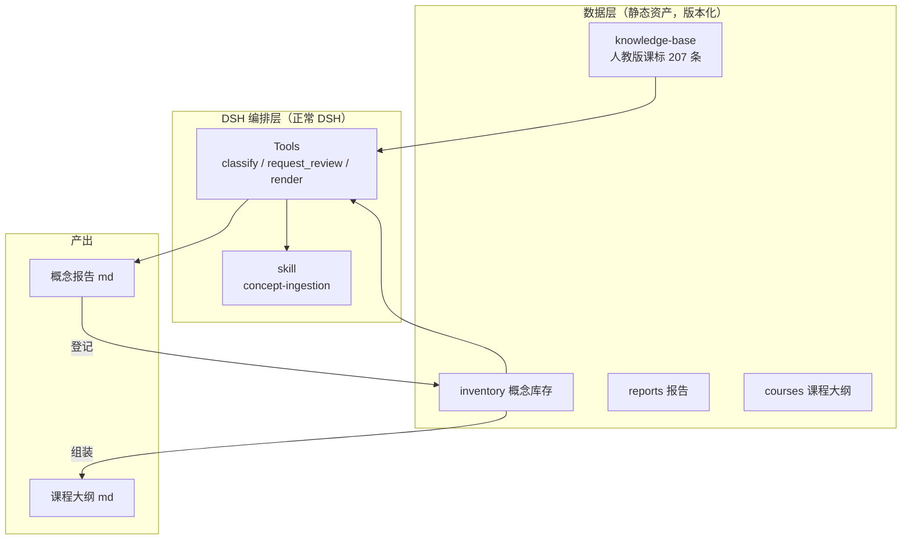
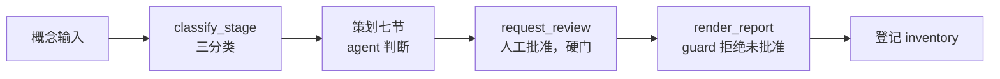
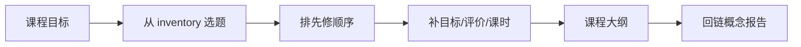

# 项目总结：已完成 / 未完成 / 架构与可复用工作流

日期：2026-11-02
版本：2.0
用途：向 tutor / 自己复盘当前进度，说明这套东西如何变成可复用工作流
关联：`01`~`14` 全部文档、`../Objectives.txt`、`../策划报告.md`、`../README.md`

## 一 已完成的（截至本版）

### 1.1 策划与选型

- `01-选型建议.md`：底座选 **DSH 原生（方案 A）**，super-agent 暂不接入，RAG 独立经 MCP 暴露。
- `02-工作流设计.md`：两层工作流（概念层 → inventory；课程层 → 组课），三分类定位，工具清单，报告模板。

### 1.2 知识库（RAG 第一阶段）

- `../knowledge-base/04-知识库映射表.md`（索引 + schema + 判定规则）+ 六科明细（数学/物理/化学/生物/信息科技）。
- **207 条**条目（数学 47、物理 49、化学 32、生物 56、信息科技/信息技术 23），全部由并行 agent 逐条核实官方课标与教材目录。
- 定位规则三分类（初高中课内 / 大学先修 / 库外原型），卷积判定示例已验证。

### 1.3 可运行闭环（已实现 + 已装进 profile 验证）

- `../bundle/`：一个可安装的 DSH bundle，注册三个工具 + 一个 skill：
  - `classify_stage`：读 207 条知识库，三分类（含关键词/别名匹配）。
  - `request_review`：渲染前的人工复核门（向用户呈现"定义 + 可视化形式"，等批准）。
  - `render_report`：套七节模板渲染 md 落盘，**未经批准被 guard 拒绝**。
  - `concept-ingestion` skill：随 bundle 自动注册，指导 agent 按固定五步走入库流程。
- 已验证：分类 7/7 正确；skill 可发现性（随 bundle 启用/禁用正确注册/卸载）；硬门（跳过复核直接渲染会被拒绝）；skill TDD（有 skill 停在复核门，无 skill 直接渲染）。

### 1.4 内容生产（概念层产出）

- `../reports/`：卷积（cnv-001）为 Pilot；ai-001 ~ ai-006 六份课件策划报告（智能边界、数据与特征、监督/无监督、神经网络、梯度下降、AI 伦理）。
- `../inventory/05-概念Inventory.md`：7 个概念已登记（1 个 Pilot + 6 个 prototype）。

### 1.5 课程组装（课程层产出）

- `../courses/06-课程大纲-人工智能入门.md`：第一门课《人工智能入门》，7 模块、先修关系、与初高中课程的关联表。
- `14-给导师的汇报.md`：面向导师的业务层汇报（含 mermaid 流程图）。

## 二 未完成的（明确列出的 gap）

| 类别 | 待办 | 依赖/说明 |
| --- | --- | --- |
| 知识库 | 大学理工科（二期） | 信号与系统、图像处理、深度学习等，支撑"大学先修"分支 |
| 知识库 | 2024 新教材目录对齐 | 初中四科新教材正在启用 |
| 平台 | `search_curriculum` 语义检索 | 当前 classify 是关键词匹配，不是向量检索 |
| 平台 | RAG 向量检索 + MCP 暴露 | 知识库目前是静态 md |
| 平台 | workflow 多智能体编排 | 目前是 skill + 工具，未用 workflow 串成流水线 |
| 内容 | 7 份报告的学科审阅 | 未经审阅，不能上线 |
| 工程 | Unity 课件实现 | 目前只有"如何设计课件"的策划稿 |
| 工程 | 真机验证、学生效果评价 | 对应 `../策划报告.md` 阶段 3/4 |

**下一步最小一件事**：把《人工智能入门》7 个概念全部走完 `request_review` 人工复核 + `render_report`，产出第一门可交付的完整课程策划。

## 三 已实现的 agents / skills

| 角色/技能 | 状态 | 落地形态 |
| --- | --- | --- |
| 概念入库流水线（concept-ingestion） | ✅ 已实现为 skill | 随 bundle 注册，五步：分类→策划→复核→渲染→登记 |
| 概念三分类（classify_stage） | ✅ 已实现为工具 | 确定性代码 |
| 人工复核（request_review） | ✅ 已实现为工具 | 硬门，调用 userQuestions |
| 报告渲染（render_report） | ✅ 已实现为工具 | 确定性代码 + guard |
| 内容助理 / 质量评价 / 项目统筹 / 项目秘书 | ⏳ 设计已定义，未单独落地 | 见 `02-工作流设计.md`，可用 skill 逐步补齐 |

## 四 架构

- 数据层（知识库/库存/报告/课程）与编排层（DSH bundle）解耦，通过 `cordis.patch.yml` 的路径配置交互。
- 换 pi 或接公司底座时，只换编排壳，不动数据。

## 五 可复用工作流（mermaid）

### 5.1 概念入库流水线（已实现）

### 5.2 课程组装流水线（设计已定，未自动化）

### 5.3 为什么这是"可复用"的

1. **概念层可复用**：任何概念走同一条流水线，产出同一 schema 的报告。
2. **课程层可复用**：inventory 是素材池，多门课从中选概念，互不复制正文。
3. **数据与编排解耦**：换概念、换学科、换底座都不动流程定义。
4. **人工把关是硬门**：`request_review` + guard，不依赖 agent 自觉。

## 六 判断边界

- 知识库条目为课标主线/教材目录级证据，非页码级原文。
- 7 份报告为策划稿，未经学科审阅与真机验证。
- bundle 已装进当前 profile 并验证工具注册/硬门/skill 可发现性，但尚未做真实的"真人点批准"端到端。
