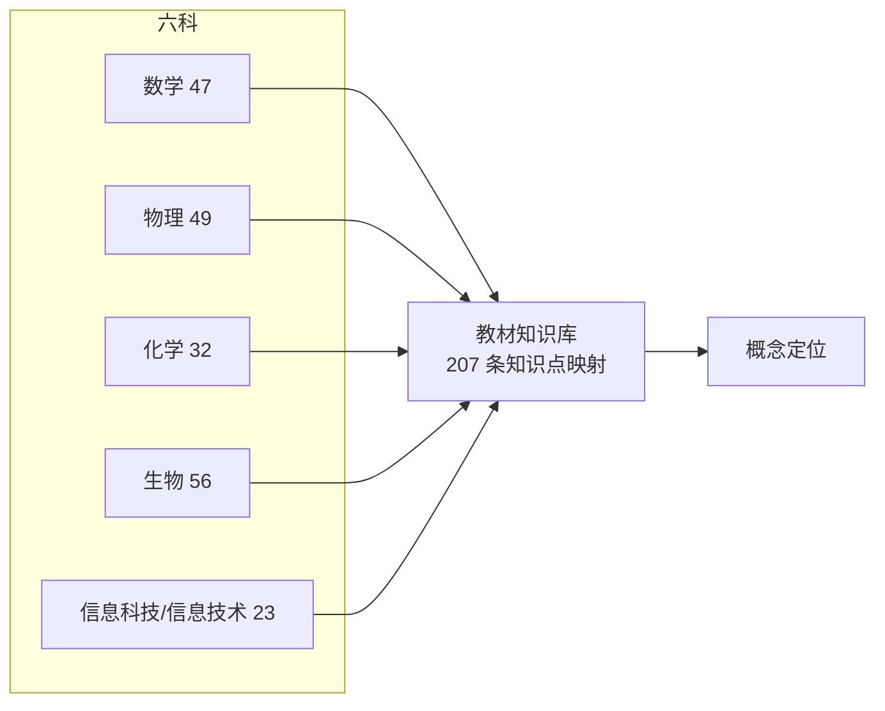
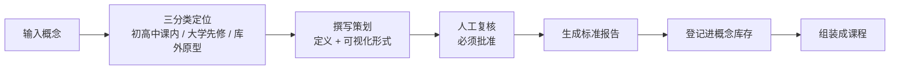
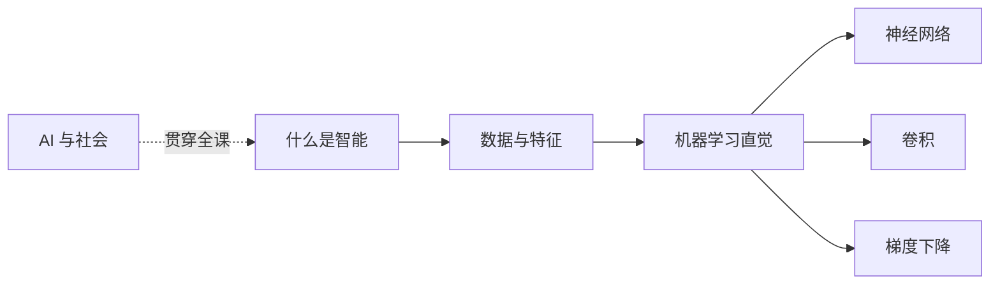
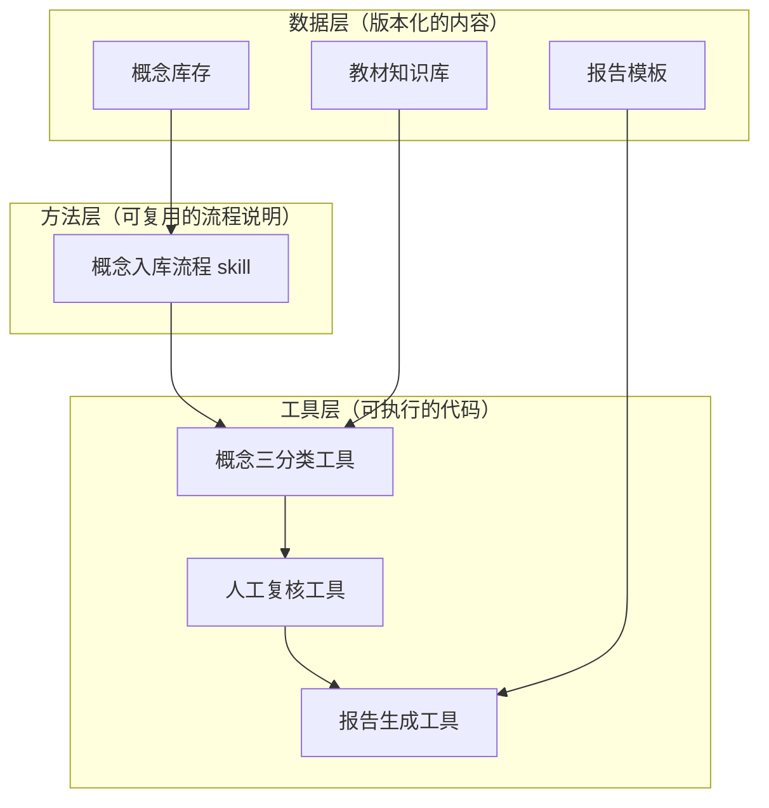

# BNU 课件工作流项目汇报

日期：2026-11-02
用途：向导师汇报项目进展与下一步规划（业务层面）
阅读对象：导师 / 项目负责人

---

## 一、一句话概括

我们从"**做一个卷积可视化课件**"出发，走到"**一套可复用的流水线，把任意学科概念自动变成有教材依据、有人工把关的课件策划稿**"，并已经跑通了第一个完整闭环。

---

## 二、我们的起点与转折

### 起点：一个 Unity 卷积课件

最初的想法很具体：给初高中生做一个 AI 课程，第一课是**卷积的可视化**，用 Unity + AR 呈现"滑窗 + 加权求和"这个抽象概念。

### 转折：发现真正的问题

做第一个课件的过程中我们发现，真正值钱的不是"这一个课件"，而是背后这套流程：

- 一个概念，要搞清楚它**属于哪个年级、哪门课**（很多概念不在初高中课本上，比如卷积其实是大学内容）；
- 要查**教材依据**，不能凭空编；
- 要设计**课件怎么交互**，不能只看动画；
- 产出要**可交接、可复用**，不能每次重写。

于是我们把目标从"做一个课件"升级成"**做一套生产课件的流水线（harness）**"。卷积从一个孤立任务，变成了这套流水线的**第一个测试用例（pilot）**。

---

## 三、我们已经做完的

### 1. 一套教材知识库

把人教版**数学、物理、化学、生物、信息科技、信息技术**六科的初高中章/单元级目录，整理成一张结构化的"知识点 → 年级/科目"映射表，共 **207 条**。

### 2. 一套标准工作流（harness）

把"概念 → 课件策划报告"的过程固定成六个步骤，任何概念都走同一套流程：

关键设计：**中间有一道人工复核闸门**——概念怎么定义、用什么形式可视化，必须先给老师看、批准了才能定稿。这一步不是摆设，我们已经验证过：不批准，系统直接拒绝出报告。

### 3. 第一批产出：人工智能入门课

以卷积为 pilot，我们搭出了第一门课《**人工智能入门**》，共 7 个概念：

每个概念都有一份策划报告，包含：准确定义、直觉解释、课程覆盖定位、可视化形式、交互设计。

---

## 四、当前的技术架构（业务视角）

这套流水线跑在一个"底座"上，分三层，**数据、方法、工具三者分开**：

**这套架构的意义**：以后换概念、换学科、甚至换底座，都只动对应的一层，不动整体。

---

## 五、之后要做的（业务层面）

按优先级排，都是"让这套流水线真正服务于实验室"的事：

| 阶段 | 做什么 | 业务价值 |
| --- | --- | --- |
| **近期** | 把《人工智能入门》7 个概念全部走完复核 | 拿到第一门可交付的完整课程策划 |
| **中期** | 概念库存扩展到更多学科（数学/物理的零散概念） | 积累可复用的课件素材池 |
| **中期** | 接入大学理工科课程（信号与系统、深度学习等） | 支撑"大学先修"类概念（如卷积） |
| **远期** | 从策划稿进入 Unity 实际开发 + 真机验证 | 产出真正能上手的 AR 课件 |
| **远期** | 沉淀成实验室可交接的规范与模板 | 让新成员能独立复现，不再靠拷贝 |

---

## 六、这套东西对实验室意味着什么

1. **可复用**：今天做一个概念，明天做一百个，流程不变、质量不降。
2. **有依据**：每个课件的"属于哪个年级、依据哪本教材"是可追溯的，不靠记忆。
3. **有人把关**：人工复核是硬闸门，AI 负责出稿，人负责拍板。
4. **可交接**：知识库、库存、模板都是版本化的文件，不是某个人的电脑里的散文件。

---

## 七、下一步最想推进的一件事

**把《人工智能入门》这门课完整交付**：7 个概念全部经人工复核、生成报告，作为这套流水线的第一个"成品"，给导师和实验室一个看得见、能复用的样板。
