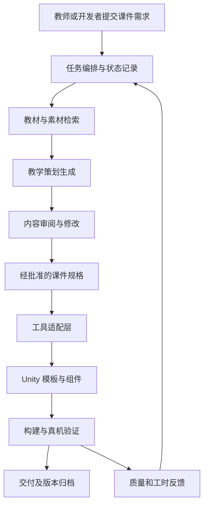

# BNU 教育技术实验室研发规范化与智能体辅助课件平台策划报告

日期：2026 年 10 月 27 日  
版本：1.0  
用途：个人决策、与 tutor 沟通试点，以及后续技术方案讨论

## 一 项目建议

建议以一个真实课件项目为试点，先建立可复现的 Unity 开发流程与可复用组件，再引入教材知识检索和智能体辅助策划，最终形成能够支持教育研究的课件生产平台。

最先需要验证的，是新流程能否帮助实验室成员更快完成可信、可运行、可交接的课件。Git 托管、MCP、RAG 和多智能体应围绕这一目标逐步引入。平台规模和技术先进程度本身不宜作为成功标准。

首个试点建议选用实验室已有积累的“凸透镜成像”课件：它同时涉及教材依据、物理规则、交互设计和 AR 展示，便于比较改造前后的工作量。若该项目缺少可用源码或素材，则改用现有资源最完整的正方体展开图项目。第一阶段暂不同时推进 STEM 与历史人物对话两条产品线。

推荐路线是：**一个项目跑通 → 一套规范复用 → 教材到课件的流程半自动化 → 通过实验判断是否值得扩展平台。**

本报告中的实验室现状来自 Objectives.txt 的个人观察，尚未经实验室访谈或代码审计确认。周期、资源配置和验收数值均为策划建议，不代表已有成果或实验室承诺。

## 二 发起动机与个人目标

### 2.1 合作基础

你曾在 BNU 教育技术实验室实习，参与过实际项目，并持续与 tutor 保持联系。这为识别真实问题和争取小范围试点提供了基础。对外沟通时，宜展示曾经完成的具体工作、成果和协作经验，避免用对他人能力的评价作为说服依据。

实验室已有的课件开发经验、教育研究场景和师生资源，是这个项目的重要条件。你的贡献则可以集中在工程流程、智能体应用和平台架构上，形成互补合作。

### 2.2 希望解决的问题

你希望把依赖个人经验和复制粘贴的开发方式，逐渐变成可积累、可复用、可追溯的实验室能力。同时，希望探索教材知识如何约束 AI 生成，以及怎样把策划、开发与研究评价衔接起来。

### 2.3 对你的价值

| 目标 | 希望获得的实际成果 | 成立条件 |
| --- | --- | --- |
| 提升架构能力 | 一套有真实使用者、可解释设计取舍的平台原型 | 参与需求、实现、验证与交接全过程 |
| 深化科研合作 | 可复现实验、共同研究问题和持续合作机会 | tutor 认可问题，研究设计与贡献分工明确 |
| 建立个人作品 | 可公开展示的演示、架构说明与过程记录 | 获得相应展示授权，避免披露内部材料 |
| 验证公司技术路线 | 检验底座、RAG、运行时及插件在教育场景中的适配性 | 明确公司资产、实验室数据及个人成果的使用边界 |
| 形成长期影响 | 实验室成员能够独立使用、维护和扩展成果 | 有第二维护人，交接材料完整 |

建议在试点开始前记录四项约定：投入时间上限、成果归属、公开展示范围，以及后续合作方式。论文署名应根据实际贡献和合作规则讨论，不应作为提供技术支持的预设交换条件。

## 三 现状判断与优先级

| 观察或设想 | 当前证据状态 | 可能造成的影响 | 首轮验证方式 |
| --- | --- | --- | --- |
| 通过网盘、移动硬盘传递项目，缺少 Git 流程 | 来自你的观察，需确认覆盖范围 | 版本混乱、回退困难、交接成本高 | 查看一个活跃项目最近三次交付方式 |
| 缺少统一模板，通用代码靠复制复用 | 来自你的观察 | 重复开发、修复难以传播 | 对比两个课件的初始化、平面识别和交互代码 |
| Unity 版本可能不统一 | 推测 | 项目导入或构建失败 | 收集编辑器、插件、构建链与设备版本 |
| 智能体可能提高研究产出 | 待检验的价值假设 | 可能节省制作时间，也可能增加调试负担 | 记录现有策划与开发流程的基线工时 |
| 华为 AR Engine 可能不适配新版 Unity | 未确认的兼容性风险 | 限制升级和新设备支持 | 用真实项目和设备建立兼容性测试矩阵 |
| 实验室可能不愿使用 GitHub | 尚未确认的偏好 | 影响托管选型 | 分清网络可用性、数据管理要求与个人习惯 |

建议按以下顺序处理：项目可复现与交接 → 模板和组件复用 → 教材到策划的证据链 → 自动生成与工具调用 → 教学效果研究。

“没有采用某项工具”并不能直接说明流程无效。应先确认问题实际发生的频率和成本，再选择改造范围。

## 四 如何争取实验室支持

### 4.1 各方关心什么

| 对象 | 值得验证的需求 | 最有说服力的证据 |
| --- | --- | --- |
| tutor 与项目负责人 | 减少指导重复劳动，降低学生毕业后的交接风险 | 新成员按文档独立运行旧项目的记录 |
| 研究生和开发成员 | 更快完成课件，减少环境和插件问题 | 同类任务的耗时与返工次数对比 |
| 教师与内容审阅者 | 内容有依据、难度适合、交互服务教学目标 | 带教材定位的策划稿及可修改演示 |
| 实验室管理者 | 维护成本可控，资产和权限清晰 | 维护责任、备份恢复方案及退出方案 |

这些是访谈假设，不应直接当作 tutor 的真实动机。首次沟通应围绕最近一个具体项目，了解“最费时间的环节”和“最担心的交接问题”。

### 4.2 建议的沟通表达

> 我想先选一个现有课件做小范围试点，把项目整理到其他同学能够复现，并把通用功能沉淀下来。随后加一个能够查教材依据、生成课件策划初稿的助手。我们记录实际节省了多少时间、出现了哪些问题，再决定是否扩大。我希望承担技术方案和试点推进，也希望一起明确后续研究合作与成果展示的范围。

首次争取的资源应尽量具体：一个可使用的项目副本、一位试用成员、一位内容审阅者、一台目标设备，以及每周一次简短反馈。先明确这五项，再决定是否申请服务器或更多预算。

## 五 路线比较与范围控制

| 路线 | 工作内容 | 优点 | 局限 | 建议 |
| --- | --- | --- | --- | --- |
| A 研发流程整理 | Git、版本清单、模板、组件、交接文档 | 收益容易验证，范围较小 | 教育 AI 研究空间有限 | 作为必做基础 |
| B 流程整理加策划助手 | A 加教材检索、策划生成、人工审阅及受控导出 | 同时验证工程价值和内容生产价值 | 需要教材整理与评价设计 | 推荐作为首轮目标 |
| C 全流程自主平台 | 自主选题、多角色协商、代码和素材生成、部署、学习者适应 | 覆盖面大 | 数据、权限、维护与评价成本高 | 留作远期方向 |

首轮最小可用版本应包含：一个可复现的 Unity 样例、一组通用组件、一小批有来源的教材知识单元、一个带引用的策划生成流程、一套审阅记录，以及完整的试点数据。

首轮不纳入全学科覆盖、任意 3D 素材自动生成、自动论文撰写、无人审阅发布和学生个性化画像。历史人物对话可在流程稳定后作为第二类课件验证，重点处理原文、史实与创作性表达的区分。

## 六 研发基础建设

### 6.1 Git 托管选择

目标是形成可追溯的协作方式，自建 GitLab 是候选实现。GitLab Self-Managed 有明确的硬件与基础设施要求，因此选型时应同时考虑服务资源、备份、升级和维护责任。[GitLab 官方部署要求](https://docs.gitlab.com/install/requirements/)

建议优先复用学校或实验室已有的受认可代码托管服务。若需要自建，可比较 GitLab 与 Gitea：GitLab 适合希望集中管理研发流程且有维护支持的场景；Gitea 提供代码托管、代码审查和协作能力，可作为规模较小试点的候选。最终以维护者熟悉程度、功能需求和实际资源测试决定。[Gitea 官方介绍](https://docs.gitea.com/)

首次迁移只选择一个活跃项目。保留原始交付归档，确认能够从新仓库恢复项目后，再逐步推广。仓库必须有实验室侧管理员，避免服务只存在于个人电脑。

### 6.2 Unity 工程规范

建议形成一份简短、可执行的工程约定：

1. 固定并记录 Unity 编辑器、AR SDK、构建工具和目标设备组合；升级单独验证。
2. 版本化保存 Assets、Packages 和 ProjectSettings，保留资产对应的 `.meta` 文件；忽略 Library、Temp、Logs 等可重建目录。
3. 使用文本序列化便于审查；对模型、音频等较大二进制资产制定 Git LFS 或资产库规则，恢复测试应覆盖资产本体。
4. 优先拆分场景与 Prefab 的负责范围，减少多人同时修改同一资产；不要假定文本格式就能安全自动合并。
5. 采用短分支、小提交、合并前检查和可回退版本；API 密钥从配置环境读取。
6. 每个项目附运行说明、版本清单、设备清单、已知问题与演示步骤。

Unity 官方文档说明了资产文本序列化及外部版本控制相关设置；具体菜单和行为需要以试点锁定版本为准。[Unity Editor 设置文档](https://docs.unity3d.com/2023.1/Documentation/Manual/class-EditorManager.html)

### 6.3 模板与共享组件

模板提供目录、示例场景、默认配置和说明。共享组件负责真正重复出现的功能，例如 AR 会话初始化、平面与锚点管理、点击放置、提示 UI、课件状态切换及事件记录。

建议将共享代码整理为带版本的 Unity package，模板引用固定版本。组件先从两个真实课件中的共同部分提取，再扩展接口，避免根据想象构造过大的框架。

业务层使用实验室自己定义的少量 AR 接口，具体供应商能力放在适配层。接口只覆盖已经用到的能力。替换 AR 后端时仍需要重新验证追踪、锚点、权限、性能和设备支持。

### 6.4 AR Engine 的验证方案

华为官方公开示例能够证明其提供 AR 功能的示例项目，但该 Android 示例不能证明某一 Unity 插件与某一新版 Unity 兼容。目前应保留“兼容性待验证”的判断。[华为官方 AR Engine 示例](https://github.com/HMS-Core/hms-AREngine-demo)

首周建立两组环境：现有项目已运行的组合，以及计划采用的候选组合。记录 Unity、SDK、插件来源、JDK、Android SDK/NDK、构建链、设备型号和系统版本。

每组检查干净导入、构建安装、权限处理、平面识别、模型放置、会话恢复和连续运行。若候选组合失败，先锁定已通过组合并记录限制，再评估适配或更换后端；不把自动升级作为试点的默认前提。

## 七 平台架构建议

### 7.1 总体结构

建议采用一个应用中的分层模块，先用明确的步骤连接任务。初期无需拆成大量服务，也无需让所有角色持续相互对话。

| 层次 | 主要责任 | 建议保留的记录 |
| --- | --- | --- |
| 交互入口 | 接收学科、教材版本、章节、设备及教学目标 | 需求单与补充信息 |
| 任务编排 | 确定下一步、等待审阅、重试或停止 | 任务状态、负责人、失败原因 |
| 智能体运行时 | 调用模型与工具，保存会话，限制调用次数和成本 | 模型、提示词版本、工具调用记录 |
| RAG 引擎 | 整理材料、检索证据、返回可定位引用 | 文档版本、片段、页码、检索结果 |
| 插件与工具 | 操作知识库、代码库和 Unity 环境 | 输入输出、变更范围、日志 |
| 课件运行环境 | 执行教学交互和 AR 展示 | 课件版本、设备结果、批准的事件数据 |

需要区分“智能体运行时”和“学生使用课件的运行环境”。前者帮助生产课件，后者执行教学内容。首版课件不必依赖实时大模型才能使用。

### 7.2 如何借鉴 pi

本报告将你提到的 pi 理解为 pi coding agent 及其工具包。其原 badlogic/pi-mono 地址当前重定向至 earendil-works/pi。官方说明提供可扩展的 agent harness、扩展机制、SDK 和模型调用相关组件；子智能体并非默认内置功能。[pi 官方仓库](https://github.com/earendil-works/pi)

可以借鉴“小核心加扩展”的组织方式，优先复用模型适配、工具调用和会话能力。实验室自己的知识结构、课件规格、审批状态和评价标准应由业务层维护。

若直接使用 pi，需要补齐任务编排及执行隔离。其官方说明明确指出默认没有限制文件、进程、网络和凭据访问的内置权限系统。MCP 或插件接入也不能代替这些控制。[pi 权限说明](https://github.com/earendil-works/pi#permissions--containerization)

如果公司的现有底座已经具备这些能力，应优先做一次接口适配验证；通过后复用底座，未通过再考虑独立实现。决定依据包括导出能力、可维护性、数据边界和后续授权条件。

### 7.3 MCP 的适用边界

MCP 用于让模型应用通过统一协议连接工具、资源等能力。编码规范仍需依靠模板、组件接口、静态检查、构建测试和人工审阅落实。[MCP 官方架构说明](https://modelcontextprotocol.io/docs/learn/architecture)

首轮可先实现内部函数或命令；有多个调用端需要共享时再封装为 MCP。建议的工具接口包括：

| 工具 | 输出 | 约束 |
| --- | --- | --- |
| `search_curriculum` | 带教材版本和页码的证据片段 | 只检索获准材料 |
| `validate_lesson_spec` | 缺失字段、引用及约束问题 | 校验结果不能代替学科审阅 |
| `create_lesson_project` | 从固定模板创建项目 | 写入指定工作目录 |
| `run_unity_checks` | 构建与检查报告 | 固定命令范围、超时及并发限制 |
| `prepare_change_review` | 代码差异、测试结果和变更说明 | 由维护者决定是否合并 |

模型提议工具调用，服务端验证参数和权限。失败步骤应保存日志并返回明确状态；建议最多自动重试两次，继续失败则进入人工处理，防止无限修复循环。

## 八 教材检索与课件策划流程

输入“物理”或“语文”不足以确定课件。系统应逐步补齐年级、教材版本、章节、学习目标、课时、目标设备和已有素材；未知项可以显式保留，不应自行假定。

建议按以下流程生成：

1. **确定范围**：定位教材版本、章节和知识点，确认是否在知识库覆盖范围内。
2. **检索证据**：按版本与章节过滤，再结合关键词和语义检索；返回原文片段、页码与文档版本。
3. **整理教学依据**：列出学习目标、先修知识、常见误解、可视化需求及待确认内容。
4. **生成交互方案**：明确学生操作、系统反馈、教师提问、形成性评价和结束条件。
5. **审阅与定稿**：学科审阅者检查正确性和年龄适宜性，开发者检查实现成本。
6. **生成工程规格**：把批准内容映射为模板参数、组件引用和少量必要脚本。

教材知识单元至少包含：学科、年级、出版社、版次、章节、知识点、原文位置、图表说明、公式、先修关系和使用权限。扫描材料需要 OCR 校验，公式和配图不能只依赖普通文本切分。

“检索到了相似内容”不等于“该知识属于指定教材”。无法确认时应返回缺少证据、多个版本候选或库外内容；有冲突时展示冲突来源，由审阅者选择。

### 8.1 标准课件规格

每份课件规格应包括：身份与版本、适用对象、教材依据、可观察的学习目标、交互步骤、知识约束、素材列表、评价方式、实现依赖、审阅意见和验收步骤。内容证据与工程实现通过知识点编号和步骤编号关联。

### 8.2 凸透镜课件示例

学生先预测物体移动后像的变化，再拖动物体观察光路，最后解释预测与结果的差异。策划助手负责根据教材组织任务、问题和反馈，物理参数及成像关系由确定性程序计算，关键边界由学科审阅者和测试案例验证。

演示应包含正常操作、临界位置和无效输入处理。进入三维展示并不能自动保证教学价值；是否提升理解，需要另外通过学习任务评价。

文科扩展可以沿用同一规格，但需增加原文、史实和角色创作的标记。例如李白角色的虚构对话应明确其创作属性，不把生成内容伪装成历史引文。

## 九 智能体角色与协作机制

建议保留你提出的 CEO、BD 和秘书三个角色，但赋予它们明确的工作产物和权限。一个角色可以是同一模型在不同任务中的配置，不必对应一个常驻服务。

| 角色 | 主要输入 | 必须交付的产物 | 决策边界 |
| --- | --- | --- | --- |
| 项目统筹 agent 即 CEO | 已确认目标、任务状态、资源限制 | 优先级、分工、阶段建议与升级问题 | 不替人承诺资源或改变合作范围 |
| 合作与价值 agent 即 BD | 访谈记录、试点数据、个人目标 | 各方需求假设、沟通稿、价值对照表 | 不虚构 tutor 动机，不自动对外联系 |
| 项目秘书 agent | 任务表、截止时间、阻塞项 | 下一步清单、会议摘要、提醒内容 | 不重复制造任务，不替人认定完成 |
| 教材与教学设计 agent | 需求单、教材证据 | 带引用的教学策划与课件规格 | 缺证据时提请确认 |
| 工程 agent | 批准规格、组件目录、工程规范 | 可审查的代码或配置变更 | 仅在指定项目范围执行 |
| 质量评价 agent | 规格、代码、规则与测试结果 | 缺陷清单、验收报告、回归建议 | 不作为唯一的内容正确性裁判 |
| 研究支持 agent | 论文、研究问题、实验记录 | 文献卡片、对照实验建议、证据整理 | 不编造引用，不预判显著效果 |

第一阶段可将统筹与秘书合并为项目助理，将教材检索与策划合并为内容助理；BD 和研究支持按需调用。工程生成在模板和验收条件稳定后加入。

建议的任务状态为：待澄清 → 可执行 → 执行中 → 待审阅 → 验证中 → 完成，另设阻塞与取消状态。所有角色读取同一份任务记录，避免依赖聊天记忆交接。

每个任务至少记录负责人、输入材料版本、预期产物、验收人、依赖、耗时、调用成本和下一步。统筹依据这些记录推进，质量评价给出证据，最终验收由人负责。

秘书的提醒应触发于截止时间临近、依赖完成、任务阻塞或需要决策。每条提醒包含“当前情况、下一步、预期效果、责任人”。该功能需要后续接入调度器和通知渠道，本报告不代表已经创建自动提醒。

## 十 研究参考与创新方向

### 10.1 INVITE 的启发

INVITE 的研究涵盖学习者建模、教育数据、教学智能体及非认知能力支持，强调教师参与和实证研究。对本项目的直接启发，是让平台记录可用于评价的教学交互，并邀请教师参与设计迭代。[INVITE 研究方向](https://invite.illinois.edu/research/)

其公开成果列表包含 2026 年的教学智能体工具包、教师共创及学习坚持性相关工作，可作为后续跟踪入口。本轮对这些新条目仅核对了官方书目信息，未据此推断其具体方法或实验效果。[INVITE 成果列表](https://invite.illinois.edu/publications/)

### 10.2 值得精读的研究

| 研究 | 已核对的内容 | 对项目的启发与适用限制 |
| --- | --- | --- |
| Automatic Large Language Models Creation of Interactive Learning Lessons，ECTEL 2025 | 摘要描述 RAG 与任务分解用于生成辅导教师培训课，人工评价中分步生成优于一步生成 | 可借鉴分阶段策划和评价量表；研究对象是教师培训内容，不能直接外推到 AR 课件学习效果 |
| Can LLMs Reliably Simulate Human Learner Actions，AAAI 2025 | HYP-MIX 用可检验的行为假设组织学习者模拟，在物理学习环境中验证 | 可探索误概念和异常操作的预发布测试；模拟学生不能代替真实学生实验 |
| Tutor CoPilot，2024 年首发且持续更新 | 摘要报告了真实辅导场景中的人机协作随机对照研究 | 支持优先研究“帮助教师或开发者”的路径；其效果和成本不能当作本项目预测 |

研究来源：[交互课程生成论文](https://arxiv.org/abs/2506.17356)、[HYP-MIX 论文](https://arxiv.org/abs/2410.02110)、[Tutor CoPilot 论文](https://arxiv.org/abs/2410.03017)。以上为选题参考，正式立项前应精读方法、样本、评价量表和局限。

### 10.3 建议的研究主线

**优先方向是教材约束下的人机协作 AR 课件生产。** 核心问题是：加入教材证据、结构化课件规格和审阅流程后，能否在保持正确性的同时降低制作与返工成本？

候选对照设计如下，属于本项目建议，尚不能认定具有文献层面的新颖性：

| 研究问题 | 对照设计 | 主要观察量 |
| --- | --- | --- |
| 教材检索是否有帮助 | 直接生成与带教材检索的生成 | 教材一致性、来源可追溯率、知识错误数 |
| 分步策划是否有帮助 | 相同模型的一步生成与结构化分步生成 | 盲评质量、人工修改时间、总成本 |
| 多角色审查是否值得 | 单角色分步流程与加入独立审查角色 | 错误发现率、漏报、误报和额外成本 |
| 工程模板是否有效 | 现有流程与模板组件流程 | 完成交付耗时、构建失败、交接成功率 |

独立审查角色可能产生与生成角色相似的错误，因此应结合规则校验、真实构建和人类评价。只有对照结果支持时，才将多智能体作为方法贡献。

建议先做开发者工作流研究。若再开展学生学习效果研究，应与实验室确认适用的研究审查、参与同意及数据管理流程，使用前测、后测或迁移任务，并控制教学内容与时长差异。具体样本量应由研究问题和功效分析确定。

## 十一 分阶段实施路径

以下按你每周约投入 10 至 15 小时、至少一名实验室成员配合试用、内容审阅者每周提供反馈估算。时间从资源到位后计算，八周是试点规划窗口，实际排期应在首周盘点后修订。

| 阶段 | 建议周期 | 关键工作 | 交付与继续条件 |
| --- | --- | --- | --- |
| 0 共识与基线 | 第 1 周 | 访谈、项目和设备盘点、现有流程计时、AR 兼容性验证 | 试点范围、版本矩阵、基线记录；有可运行环境和负责人才继续 |
| 1 工程基础 | 第 2 至 3 周 | 一个项目进入 Git，整理模板和首批组件，编写恢复说明 | 第二位成员从干净环境完成构建和演示 |
| 2 内容流程 | 第 4 至 5 周 | 整理一个章节的材料，构建检索、引用、策划和审阅流程 | 一份可追溯且审阅通过的策划稿；检索不足能正确暴露 |
| 3 有限工程辅助 | 第 6 至 7 周 | 将批准规格转成模板参数及必要脚本，接入检查工具 | 可审查变更、构建报告、真机演示和失败日志 |
| 4 评价与交接 | 第 8 周 | 对比耗时与质量，汇总成本，培训第二维护人 | 试点复盘及继续、缩减或暂停的决定 |

若第 1 周无法得到可运行项目和目标设备，应将试点缩为“教材检索与策划验证”，明确其尚未验证 AR 工程收益。若第 3 周交接仍无法完成，应优先补齐基础，顺延生成能力建设。

## 十二 验收指标与资源安排

### 12.1 建议的验收门槛

以下数值用于约束试点范围，应在开始前与 tutor 确认；它们不是行业标准或预期保证。

| 维度 | 建议门槛 | 取证方式 |
| --- | --- | --- |
| 工程可复现 | 至少 1 位非原作者独立完成构建与演示 | 干净环境操作记录及构建日志 |
| 内容来源 | 最终验收课件的关键教材事实均有可定位依据或明确标注为扩展内容 | 审阅者逐条核对 |
| 知识正确性 | 最终交付样例中已发现的关键知识错误全部修正 | 审阅记录与复查结果 |
| 检索行为 | 预先准备至少 30 条试题，覆盖库内、库外、版本冲突和模糊输入 | 记录检索命中、错误归属、应拒答却作答等情况 |
| 工作效率 | 目标为同等质量任务的人工总耗时降低约 20% | 同时统计策划、审阅、返工和维护时间 |
| 资产可复用 | 至少一个组件被第二个课件实际使用 | 依赖记录与第二课件验证 |
| 可持续维护 | 有第二维护人，完成一次仓库及资产恢复演练 | 恢复记录、维护手册和责任分工 |

30 条检索试题用于发现问题，不足以证明系统对所有教材和学科可靠。效率比较需控制任务难度、参与者经验和工具熟悉程度；样本较小时报告原始结果，不作过度推广。

### 12.2 资源与成本

最低协作配置是：你负责技术与推进，tutor 负责试点方向与资源协调，一位开发成员参与试用，一位学科审阅者把关内容。角色可以兼任，但应预留实际反馈时间。

硬件优先复用现有开发机和目标设备；托管服务需要稳定存储和备份。Unity 构建可先在固定开发机完成，再根据需要接入自动构建。大模型可先通过获准的 API 试验，不必预先采购本地推理设备。

成本按四项记录：人力工时、模型调用、服务器与存储、设备及软件。试点成本估算可使用“实际工时 × 内部估算单价 + 各项实际支出”，不要只统计 token 费用。为每任务设置调用预算、最大轮次和超时，由实验室确认总支出上限。

## 十三 风险与合作边界

| 风险 | 早期信号 | 对策 |
| --- | --- | --- |
| 新流程增加负担 | 成员持续回到网盘复制，模板无人使用 | 简化步骤，由试点成员共同调整，保留可操作的迁移说明 |
| 兼容性阻碍推进 | 干净导入失败或真机行为不稳定 | 锁定已验证组合，单独评估升级，不让未验证迁移拖累全部任务 |
| AI 输出可信度不足 | 错误引用、错误知识、代码无法构建 | 证据检索、结构校验、独立审阅及真机验证共同约束 |
| 自建平台无人维护 | 更新、备份和故障全由你处理 | 设置第二维护人，控制服务数量，必要时缩减范围 |
| 投入失控 | 长期修历史问题，无法形成试点产物 | 每周对照验收目标，新增需求进入待办，不自动扩展承诺 |
| 研究贡献不足 | 只有工具堆叠和演示视频 | 先定义问题、对照和指标，再决定研究扩展 |
| 公司与实验室边界不清 | 数据、源码或业务成果混用 | 分开仓库与凭据，书面确认可使用资产、输出和授权范围 |
| 材料使用范围不清 | 无法说明教材、素材或学生数据来源 | 先用获准材料，记录来源与使用范围；发布前单独核对 |

对公司底座的合作可以采取两种方式：提供具有清晰接口和退出方案的组件，或借鉴架构思想独立实现实验室原型。选择前需确认公司是否允许相应复用。试点应支持导出课件规格、知识库原始材料索引、任务记录和代码，避免合作变化导致成果不可使用。

## 十四 近期行动清单

| 顺序 | 下一步 | 建议负责人 | 产物 | 能支持的决定 |
| --- | --- | --- | --- | --- |
| 1 | 与 tutor 讨论一个最近项目的实际困难 | 你 | 一页访谈记录 | 是否存在值得共同解决的问题 |
| 2 | 确定一个课件、一位试用者和一台设备 | 你与 tutor | 试点范围单 | 能否开始真实验证 |
| 3 | 获取获准的项目副本和少量教材材料 | 实验室协调人 | 材料与权限清单 | 原型允许使用什么输入 |
| 4 | 记录当前版本并完成一次干净构建 | 你与开发成员 | 基线日志及兼容性矩阵 | 技术改造从哪里开始 |
| 5 | 确认维护人、投入上限和合作边界 | 你与相关负责人 | 简短试点约定 | 是否具备持续推进条件 |
| 6 | 演示第一个可复现模板，再接策划助手 | 你 | 样例与评价记录 | 是否进入下一阶段 |

第一次沟通后，最重要的决策是能否获得真实试点支持。若支持不足，先将工作收敛为个人可展示的小型原型；若实验室愿意提供项目、设备和反馈，则按阶段推进，并在每次验收后决定下一笔投入。

## 十五 资料来源与判断边界

项目动机、合作背景和现状观察依据本目录中的 Objectives.txt。外部资料于 2026 年 10 月 27 日检索，链接已放在相应论述处。技术资料采用官方文档或维护者仓库，研究参考采用机构官网及论文作者发布页面。

本轮资料核查能够支持组件定位和研究选题方向，不能替代对实验室实际工程的检查，也不能证明方案具有尚未发表的创新性。正式研究立项前，应进一步完成相关工作比较、可复现实验设计和必要的材料授权确认。
